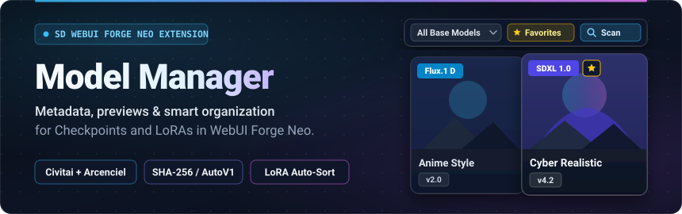

<p align="center">
  
</p>

# SD Forge Model Manager

An extension for **WebUI Forge Neo** that fetches model metadata and preview images from **Civitai** and **Arcenciel**, organizes Checkpoint and LoRA files on disk, and upgrades Extra Networks cards with live filtering and one-click management actions.

---

## Key Features

### Extra Networks Toolbar
- **Base Model Architecture Filter**: Filter cards instantly by architecture (`SD 1.5`, `SDXL 1.0`, `Flux.1 D`, `Flux.2 Klein`, `Pony`, `Illustrious`, etc.).
- **Favorites Filter**: Toggle **⭐ Favorites** to show only starred models.
- **Background Scanner & Progress Bar**: Scan unindexed models with real-time progress. Hold <kbd>Shift</kbd> + Click **🔍 Scan** to force a full rescan.

### Card Enhancements & Action Bar
Each Checkpoint and LoRA card gets a clean display title (version suffix stripped), a version badge, an architecture badge, and a hover action bar:

| Action | Description |
| :--- | :--- |
| **⭐ Toggle Favorite** | Star or unstar a model; persisted in its `.metadata` sidecar across rescans. |
| **🌐 Open Source Page** | Open the model's Civitai or Arcenciel page in a new tab. |
| **🏷️ Insert Trigger Words** | Append trained activation words directly to the active `txt2img` or `img2img` prompt. |
| **⚙️ Edit Metadata** | Edit display title, base model, version, trigger words, source URL, or upload/select a local preview image. |
| **✏️ Rename Model** | Rename the model file together with all matching sidecars. |
| **🗑️ Safe Delete** | Move the model and its sidecars to the OS Recycle Bin. |

### Metadata, Previews & File Organization
- **Dual-Source Hash Lookup**: Queries Civitai and Arcenciel using full **SHA-256** or fast **AutoV1** (with automatic SHA-256 fallback on miss).
- **Optimized Local Previews**: Downloads static preview images (skipping videos/GIFs and filtering by NSFW level) and saves downscaled `.preview.jpg` files.
- **LoRA Category Auto-Sorting**: Optionally sorts LoRAs into `Character`, `Style`, `Clothing`, `Concept`, `Pose`, `Background`, or `Utility` subfolders based on online tags.
- **Auto-Rename & Collision Protection**: Standardizes filenames (`Model_Version`, `Model - Version`, `Original Civitai Filename`, or `Model Only`) with `- Duplicate N` numbering or skip-on-conflict.
- **Atomic Sidecar Writes**: Stores metadata in portable `.metadata` files written atomically via temp-file replacement.

---

## Installation & Setup

### Option 1: Install via WebUI (Recommended)
1. Open **WebUI Forge Neo** → **Extensions** → **Install from URL**.
2. Paste:
   ```text
   https://github.com/Primer0x41/sd-forge-model-manager
   ```
3. Click **Install**, then go to **Installed** → **Apply and restart UI**.

### Option 2: Manual Clone
```bash
git clone https://github.com/Primer0x41/sd-forge-model-manager extensions/sd-forge-model-manager
```
Restart WebUI Forge Neo. Required Python packages (`aiohttp`, `Pillow`, `send2trash`) are installed automatically by [install.py](install.py) on startup.

---

## Usage Examples

### 1. Scan New Models (or Force Rescan)
- Open the **Checkpoints** or **LoRA** tab in Extra Networks and click **🔍 Scan** to fetch metadata and previews for models missing a `.metadata` sidecar or local preview.
- Hold <kbd>Shift</kbd> and click **🔍 Scan** to re-fetch online metadata for all models, or click **⏹ Cancel** at any time to stop an active scan.

### 2. Filter & Insert Trigger Words
1. Select an architecture (e.g., `Illustrious` or `Flux.1 D`) from the toolbar dropdown, or click **⭐ Favorites** to narrow the grid.
2. Hover over a LoRA card and click **🏷️** to append its `trainedWords` directly into your active prompt box.

### 3. Customize Metadata & Previews
1. Hover over any card and click **⚙️** to open the **Edit Model Metadata** modal.
2. Override the card's **Display Name**, choose a **Base Model** (or pick `Other` for a custom name), update **Trigger Words**, or browse/upload a local `.png`/`.jpg`/`.webp` preview image.
3. Click **Save** — the preview is downscaled to your configured width and old conflicting preview files are cleaned up automatically.

### 4. Auto-Organize LoRAs on Scan
1. Go to **Settings ➔ Model Manager**.
2. Enable **Auto-sort LoRA into category subfolders** (and optionally **Auto-rename model files**).
3. Click **🔍 Scan** in the LoRA tab; matched LoRAs and their sidecars are moved into category subfolders while preserving your existing directory root.

---

## Settings Reference

All options live under **Settings ➔ Model Manager**:

| Setting | Default | Description |
| :--- | :--- | :--- |
| **Civitai API Key** | *(empty)* | API key for private, early-access, or mature Civitai models. |
| **Arcenciel API Key** | *(empty)* | API key for Arcenciel lookups. |
| **Primary Metadata Source** | `civitai` | First service queried before falling back (`civitai` or `arcenciel`). |
| **Preview Image Width** | `512` | Max dimension for saved `.preview.jpg` files (`256`, `512`, `1024`, `2048`, `original`). |
| **Auto-sort LoRA into category subfolders** | `False` | Moves scanned LoRAs into tag-based category folders. |
| **Maximum NSFW level for preview images** | `Soft` | Preview filter level (`None`, `Soft`, `Mature`, `X`). |
| **Max concurrent API requests** | `3` | Concurrent scan workers (`1` to `10`). |
| **Enforce Custom Card Dimensions (280x420)** | `True` | Applies uniform `280x420` Extra Networks card sizing. |
| **Hash Algorithm** | `SHA256` | `SHA256` (full file) or `AutoV1 / Quick Hash` (fast Civitai lookup). |
| **Auto-rename model files** | `False` | Renames scanned models to match remote names. |
| **Rename Format** | `Model_Version` | `Model_Version`, `Model - Version`, `Original Civitai Filename`, or `Model Only`. |
| **Duplicate Handling Policy** | `Auto-number` | Appends `- Duplicate N` or skips renaming on collision. |
| **Also rename already-cached models on rescan** | `False` | Applies rename rules to cached models during a full rescan. |
| **Rescan all models** | `False` | Forces full metadata re-fetch on every scan. |
